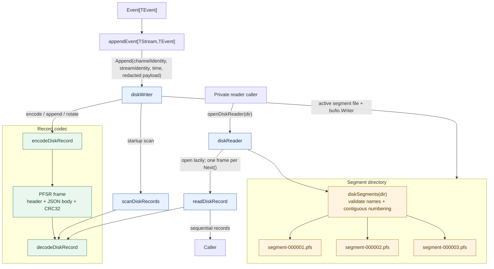
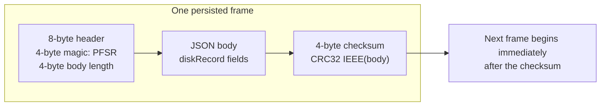
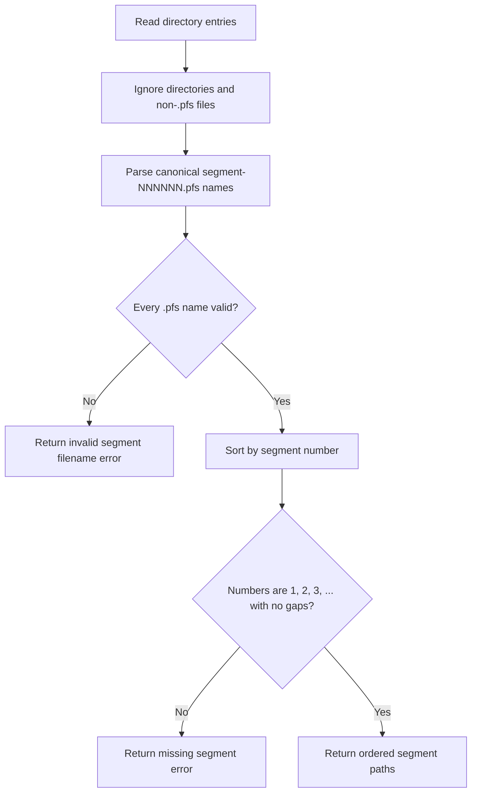
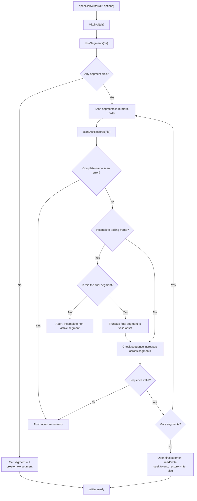
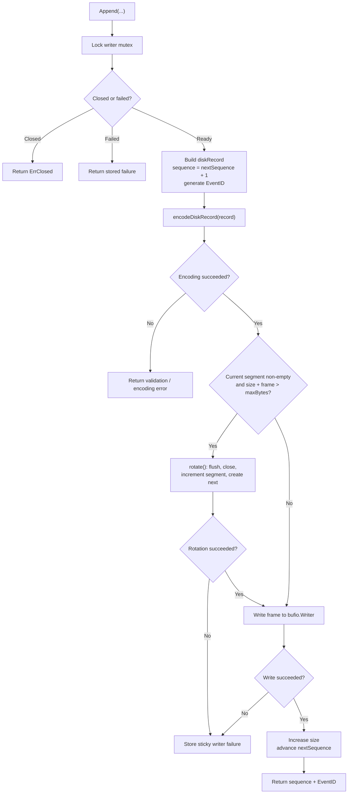
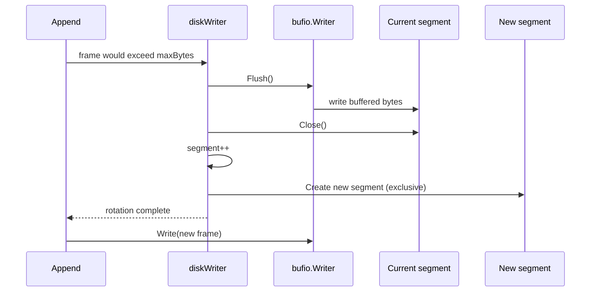
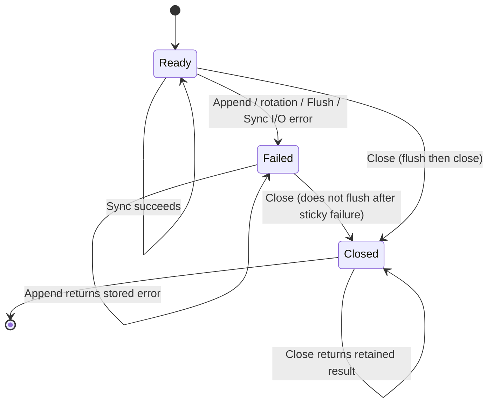
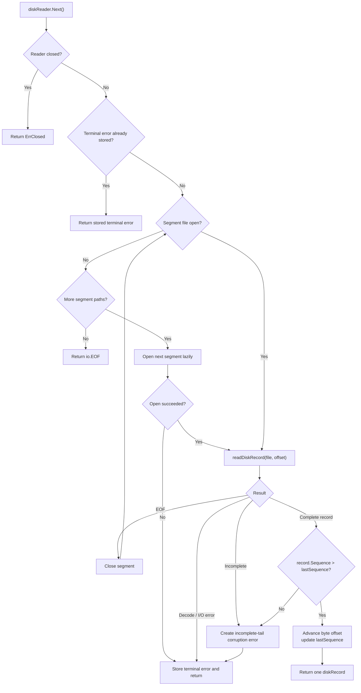

# Disk Storage Architecture

> **Scope:** This document describes the private, append-only disk storage implementation in `storage_disk.go`.
> It is an implementation map, not a public storage API specification. The diagrams are written in Mermaid and render on GitHub.

## 1. What this file is responsible for

`storage_disk.go` owns the low-level mechanics for turning already-prepared event data into durable, ordered records and reading those records back from segment files.

It has four main responsibilities:

1. **Record codec** — encode and validate one versioned, checksummed record frame.
2. **Segment discovery** — identify valid segment files and enforce contiguous numbering.
3. **Writer and recovery** — append records, rotate files, flush/sync, and recover the next sequence after restart.
4. **Sequential reader** — lazily read one frame at a time across segments and fail closed on corruption.

The writer and reader are private implementation types. This file does not expose a public storage API, database abstraction, index, or distributed coordination layer.

## 2. Component map

This is the high-level relationship between typed Event persistence and the filesystem. The private `appendEvent[TStream,TEvent]` adapter owns the event-to-record boundary: it validates the Event, serializes and redacts its payload, derives channel/stream identities, and passes creation time to the low-level writer.



### Responsibilities at a glance

| Component | Responsibility | Important property |
|---|---|---|
| `diskRecord` | In-memory representation of one persisted event | Contains event UUID plus type-derived channel and stream identities |
| `encodeDiskRecord` | Validate fields and create a frame | Rejects missing required fields, unsupported version, and oversized body |
| `decodeDiskRecord` | Validate and decode one complete frame | Checks magic, length, checksum, JSON, version, and required fields |
| `diskSegments` | Discover and order segment paths | Rejects malformed `.pfs` names and numbering gaps; retains O(segment count) path metadata |
| `diskWriter` | Append and rotate segments | Serializes calls with a mutex; sequence is writer-owned |
| `scanDiskRecords` | Inspect records during writer startup | Streams one frame at a time; retains only the last sequence and valid byte offset |
| `diskReader` | Read all segments sequentially | Opens lazily and retains only the current decoded frame |

## 3. On-disk record format

Every record is stored as one frame. Frames are concatenated directly in a segment; there is no delimiter between records.



| Part | Size | Encoding / meaning |
|---|---:|---|
| Magic | 4 bytes | ASCII bytes `PFSR` |
| Body length | 4 bytes | Unsigned 32-bit big-endian JSON body length |
| Body | Variable | JSON encoding of `diskRecord` |
| Checksum | 4 bytes | CRC32 IEEE of the JSON body, stored big-endian |

**Limits and validation**

- `recordVersion` is currently `3`. Version 2 and earlier records are intentionally rejected; this schema change is not an in-place reinterpretation or migration.
- `maxRecordBytes` is 64 MiB and applies to the final encoded JSON body, after `json.RawMessage` whitespace compaction and HTML escaping.
- The encoder preflights the exact JSON body size before marshaling the caller-provided payload. It validates the raw JSON and counts compaction/escaping without allocating an intermediate encoded payload; oversized bodies are rejected before the full JSON body or frame is allocated.
- The preflight preserves Go `encoding/json` encoding semantics, including field order, string escaping, `RawMessage` compaction, and HTML escaping. The stored frame format and checksum are unchanged.
- The decoder requires the frame length to match the declared body length exactly.
- A complete frame with bad magic, invalid length, checksum mismatch, invalid JSON, unsupported version, or missing required fields is rejected.
- Required record fields are version, event ID, channel identity, stream identity, sequence, timestamp, and payload.
- The payload is a `json.RawMessage`, so it is embedded as JSON rather than quoted as a string.

### Record data and identity boundaries

`diskRecord` persists:

- **Event identity:** `EventID`
- **Routing / ownership identity:** `ChannelIdentity` and `StreamIdentity` (type-derived strings)
- **Ordering:** `Sequence`
- **Metadata:** `Timestamp`
- **Type metadata:** `ChannelIdentity` and `StreamIdentity`
- **Event content:** `Payload`

These are private storage fields, not a promise that identities are exposed through a public API. The writer preserves the identity strings it is given. Redaction must happen before the payload reaches this layer; the writer itself does not redact event data.

## 4. Segment layout and ordering

The library's private storage root is the `pulsyflux-stream-data` subdirectory of the process's current working directory. At internal storage initialization, the library resolves the current working directory to an absolute path and uses `<absolute-working-directory>/pulsyflux-stream-data` for the storage directory. The library creates this directory as needed; callers do not provision or configure it, and its path is never exposed through public API. The resolved root remains fixed for that storage lifecycle even if process working directory changes later.

A storage directory contains numbered segment files:

```text
storage/
├── segment-000001.pfs
├── segment-000002.pfs
└── segment-000003.pfs
```

`diskSegments(dir)` performs discovery before the reader starts and before the writer recovers:

1. Read directory entries.
2. Ignore directories and files whose extension is not `.pfs`.
3. Parse each `.pfs` filename as `segment-NNNNNN.pfs`.
4. Reject malformed or non-canonical segment names.
5. Sort by numeric segment number.
6. Require numbering to start at 1 and remain contiguous.

The contiguous-from-one rule is appropriate for the current append-only layout. A future retention, pruning, or compaction feature would need to revisit this assumption rather than silently deleting old segments.



## 5. Writer lifecycle

### 5.1 Opening and recovering a writer

`openDiskWriter` creates the directory if needed, discovers segments, then determines the next sequence by scanning the existing files.

- With no segment files, it creates `segment-000001.pfs`.
- With existing segments, it scans **every** segment in order, not just the last one.
- Sequences must increase strictly within each segment and across segment boundaries.
- The scanner returns only the segment's last sequence, last valid byte offset, and incomplete-tail status; it does not accumulate decoded records.
- An incomplete trailing frame is recoverable only in the final/active segment.
- An incomplete frame in any earlier segment is treated as corruption.
- If the active segment has an incomplete tail, it is truncated to the last complete frame's byte offset.
- The active file is then positioned at end-of-file and wrapped in a buffered writer.



**Why scan all segments?** The sequence counter is global to the stream, not local to a file. An empty final segment can exist after a rollover interrupted an append, so recovering from only the active segment could incorrectly restart at sequence 1.

### 5.2 Append, rotation, and sequence assignment

`Append` holds the writer mutex for the entire operation. The typed `appendEvent` adapter prepares the redacted payload and type-derived identities before it calls `Append`. `Append` creates the next record with sequence `nextSequence + 1`, encodes it, rotates if the current non-empty segment would exceed the configured threshold, writes the frame, and optionally flushes and syncs it.



**Important details**

- Sequence numbers are authoritative ordering. Timestamps are metadata, not an ordering source.
- The writer generates a new event UUID for each append.
- The writer copies the payload bytes into the record before encoding. The low-level writer receives non-empty channel and stream type-identity strings from the private typed adapter.
- Rotation happens only when the current segment is non-empty and the next frame would exceed `maxBytes`.
- Therefore, a single frame larger than the configured segment threshold can occupy an otherwise-empty segment. The record-body limit still applies.
- The configured default segment threshold is 64 MiB when `MaxSegmentBytes` is not positive.
- The default is buffered writing. `SyncEachAppend` is currently unavailable on every platform. `openDiskWriter` rejects it with `errDirectorySyncUnsupported` before creating the storage directory or opening/creating segment files. No platform silently degrades to file-only syncing.

### 5.3 What rotation actually does



If flushing, closing, or creating the next segment fails during rotation, the append path records the error as the writer's sticky failure. A partially completed rotation is not silently retried by later appends.

## 6. Flush, sync, close, and writer failure semantics

The writer distinguishes buffering from filesystem synchronization:

- **Append:** writes to the `bufio.Writer`; without `SyncEachAppend`, this may not immediately reach the OS file.
- **Flush:** drains the Go buffer to the file.
- **Sync:** flushes first, then calls `os.File.Sync()` for the active segment. It does not sync directory entries and is distinct from the unavailable strict per-append mode.
- **Close:** flushes if there is no prior sticky failure, closes the active file, stores the joined result, and returns that same result on every later `Close` call.

Errors from append I/O, explicit `Flush`, explicit `Sync`, and append-time rotation are made sticky through `failLocked`. A flush failure during `Close` is also retained in the close result. Subsequent appends return the stored failure instead of pretending the writer can continue; repeated `Close` calls return the original close result.



| Operation | Buffer flush | File sync | Failure behavior |
|---|---:|---:|---|
| `Append` (default) | No | No | A write error becomes sticky |
| `Append` with `SyncEachAppend` (Linux and Windows) | N/A | N/A | Rejected at writer open with `errDirectorySyncUnsupported` before filesystem mutation |
| `Flush` | Yes | No | Error becomes sticky |
| `Sync` | Yes | Yes | File sync; error becomes sticky |
| `Close` | Yes, unless already failed | No explicit sync | Returns and retains joined failure/flush/close errors; repeated calls return the same result |

A successful `Flush` is not the same guarantee as a successful `Sync`: flush drains the userspace buffer, while sync requests filesystem persistence for the active file. Neither operation syncs the containing directory entry. Because strict `SyncEachAppend` requires both file and directory durability, the option is rejected on Linux and Windows with `errDirectorySyncUnsupported` before the storage path is created or any segment is opened. The implementation makes no strict per-append crash-durability claim on either platform.

## 7. Reader lifecycle and fail-closed behavior

The reader is deliberately incremental. `openDiskReader` validates the segment set but does not open every file. Each call to `Next` reads at most one complete record frame, then returns that record.

- Segment files are opened lazily in ascending segment order.
- `readDiskRecord` reads one header and one body/checksum.
- The decoded sequence must be strictly greater than the last sequence returned, including across segment boundaries.
- EOF closes the current segment and advances to the next.
- A short/incomplete frame is corruption for the reader; the reader does not truncate or skip it.
- Any read, decode, close, incomplete-tail, or sequence-order error becomes terminal. The reader closes the active file and returns the same terminal error on later calls.
- The reader never skips a corrupt frame to continue with a later segment.



### Reader memory profile

The reader retains the ordered segment path list plus one decoded record at a time. It does not load an entire segment into memory. Segment discovery uses `os.ReadDir` and retains O(number of segment files) path metadata, so metadata memory grows with segment count even though it does not grow with the bytes or record count inside those files.

Writer startup recovery is streaming: `scanDiskRecords` validates one frame at a time and retains only the last sequence, valid byte offset, and incomplete-tail state. Its record-processing memory is O(maxRecordBytes), independent of the number of records in a segment. The scanner and reader allocate one contiguous frame buffer (up to the 64 MiB body limit plus framing) rather than separately allocating a body and then copying it into a second full frame; JSON decoding can additionally allocate the returned `json.RawMessage` payload.

## 8. Recovery versus normal reading

These two paths intentionally treat an incomplete trailing frame differently.

| Condition | Writer startup scan | Sequential reader |
|---|---|---|
| Clean EOF after complete frame | Accept | Move to next segment / final EOF |
| Incomplete header or body at final segment tail | Truncate to last valid offset and resume | Terminal corruption error |
| Incomplete tail in a non-final segment | Reject as corruption | Terminal corruption error |
| Complete frame with bad magic/length/checksum/JSON/required fields | Reject | Terminal corruption error |
| Sequence not strictly increasing | Reject across segments | Terminal corruption error |

The recovery exception is narrowly scoped: it applies only to a short trailing frame in the final segment, where the writer can safely discard the incomplete bytes after all complete earlier frames have been validated. A complete but invalid frame is never treated as a harmless tail.

## 9. Core invariants

These are the rules that the implementation and its tests are protecting.

1. **Append-only segment sequence:** segment numbers are canonical, start at 1, and have no gaps.
2. **Global record sequence:** each appended record gets the next sequence; records must increase strictly across the entire segment set.
3. **Frame integrity:** a complete frame must pass magic, length, checksum, JSON, version, and required-field validation.
4. **No silent skipping:** readers stop at the first corrupt or incomplete record and never jump ahead.
5. **Narrow crash recovery:** only an incomplete tail in the final segment may be truncated during writer startup.
6. **Sticky writer I/O failure:** once an append/flush/sync/rotation I/O failure occurs, later appends cannot continue as if nothing happened; `Close` retains its first joined result for repeat calls.
7. **Private persistence boundary:** the disk writer is private and expects payload data to have been prepared/redacted upstream.
8. **No timestamp ordering:** sequence numbers determine persisted order; timestamps remain metadata.

## 10. Operational and design boundaries

- This is a local file-backed append-only implementation, not a multi-process coordination protocol. The writer mutex protects calls through one `diskWriter` instance; it is not a cross-process lock.
- There is no public storage API in this file.
- There is no index in this implementation. Writer recovery scans segment contents to rebuild the next sequence.
- There is no segment pruning or compaction; the current segment validator expects the full sequence beginning at segment 1.
- Startup recovery validates each frame incrementally and retains only the last sequence, valid byte offset, and incomplete-tail state; record-processing memory does not grow with the number of records in a segment.
- Segment discovery and reader state retain O(number of segment files) path metadata; aggregate segment bytes and record count within each segment do not determine the retained record-processing memory.
- Keep the diagrams and this document aligned with the implementation when frame format, recovery behavior, or writer/reader lifecycle changes.

## 11. Source map

| Symbol | Role |
|---|---|
| `diskRecord` | Persisted record model |
| `encodeDiskRecord` / `decodeDiskRecord` | Frame encoder and validator |
| `scanDiskRecords` | Startup recovery scan |
| `appendEvent[TStream,TEvent]` | Event validation, serialization/redaction, type identities, creation timestamp; private typed persistence boundary |
| `diskWriter` / `openDiskWriter` | Append, rotation, recovery, flush, sync, close |
| `asyncDiskWriter` / `newAsyncDiskWriter` | Bounded queue, ordered worker, batching, failure routing and drain-close (not yet live-integrated) |
| `diskSegments` / `segmentNum` | Segment discovery and naming rules |
| `diskReader` / `openDiskReader` | Sequential multi-segment reader |
| `readDiskRecord` | One-frame reader |
| `failSegment` | Reader terminal-error cleanup |


## 12. Cross-platform durability contract

The disk backend supports Linux and Windows for ordinary buffered writing and explicit file synchronization. The intended `SyncEachAppend` guarantee is stricter: a successful append must have flushed and synced the record file and durably persisted the directory entry for the active segment before acknowledging the append.

A reliable, supported, tested directory-entry sync implementation is not currently available for both supported operating systems. Therefore `SyncEachAppend` is deliberately rejected on **both Linux and Windows** with `errDirectorySyncUnsupported`, before `MkdirAll`, file opening, or segment creation. This keeps the option's behavior identical and prevents a platform from claiming a guarantee that another platform cannot provide.

- **Linux:** no directory-sync implementation is enabled. The Linux build rejects strict mode exactly like Windows.
- **Windows:** no directory-sync implementation is enabled. The Windows build rejects strict mode exactly like Linux.
- **Other operating systems:** strict mode remains unsupported.
- **Ordinary writes:** buffered Append, Flush, explicit file Sync, rotation, and recovery remain available on Linux and Windows. Explicit file Sync does not make a newly created segment directory entry durable and must not be described as equivalent to `SyncEachAppend`.
- **Directory creation boundary:** the library creates its private storage directory hierarchy as needed. This does not remove the need to persist segment entries created by the writer; that is why strict per-append mode remains unavailable.

The former platform-specific directory-sync helpers have been removed rather than retaining an unverified Linux-only durability path. Reintroduce strict mode only when both Linux and Windows have documented, reliable implementations and focused tests that prove the required ordering and fail-closed behavior. CI runs formatting, race-enabled tests, coverage reporting, vet, and build on both operating systems.


## 13. Version-3 identity format

**Development format note (not a release):** the current implementation uses internal record-format revision 3. This is an in-development encoding revision, not a product version, release, stability promise, or production migration boundary. It replaces UUID-based channel/stream routing identities and schema fingerprints with canonical type-derived channel and stream identity strings. It retains the event UUID, sequence, creation timestamp, and payload.

Because this project is not live or in production, record layouts may change incompatibly as the architecture is developed. Do not build migration, backward-compatibility, or mixed-version support solely to preserve earlier development formats. Do not bump the internal format revision for ordinary code changes; change it only when an actual incompatible record-encoding change requires it. There is no released storage format and no production data-adoption instruction.

Named types use package-qualified identities where available; unnamed type identities use Go's structural `reflect.Type.String()` fallback and are not guaranteed stable across code changes. Channel and stream identity strings are composed by the helpers in `type_identity.go`.


## 14. Private asynchronous writer queue (foundation only)

`storage_async.go` introduces an internal `asyncDiskWriter` around `diskWriter`. It serializes file access through one worker and uses a bounded queue. The current component is a foundation only: it is tested independently but is not yet connected to `Stream.Publish`, `EventChannel` construction/Close, the shared writer owner-count manager, or the internal ErrorStream.


### Current queue behavior

- Queue capacity is fixed at construction and admission blocks while the queue is full, using a condition variable to wait for space. This bounds queued items and applies backpressure.
- Payload bytes are copied at admission, so caller mutation after `Submit` cannot change queued data.
- The worker appends records in queue order, flushing when the batch size is reached or when the idle flush interval wakes it. `Close` stops admission, drains accepted records, flushes, and closes the underlying disk writer.
- A terminal failure retains the first error, clears pending queue items, wakes blocked producers, and notifies each distinct owner represented by the current unflushed batch and queued items. Owner references are queue-local routing data; no global channel registry is present.
- The first tests cover accepted-item ordering, draining on Close, repeated Close, payload-copy behavior, and deduplicated owner failure notification. Storage-failure injection, saturation/backpressure, concurrent producers, and lifecycle integration remain untested.

This component does not yet implement the process-wide writer manager or channel ownership counting. Its constructor is private and receives a private `diskWriter`; this is not a public storage API.


## 15. Live-stream integration is still pending

The typed persistence adapter and asynchronous queue are not yet called by `Stream.Publish` or `EventChannel` lifecycle code. The next integration stage must follow the approved contract in `docs/storage_integration_contract.md` and add focused tests for:


- **Ordering:** preserve accepted queue order and ensure live delivery follows successful queue admission.
- **Failure handling:** preflight failure must not queue or deliver; terminal disk failure rejects future persisted publishes and routes the underlying cause to affected channel ErrorStreams.
- **Backpressure:** bounded queue blocks producers without unbounded memory growth.
- **Lifecycle ownership:** process-wide writer owner count; individual Close releases; final Close drains/flushes/closes; ErrorStreams remain open until routing completes.
- **Redaction:** only redacted copies are queued; live payloads remain unchanged.
- **Replay:** explicitly deferred and not part of the initial integration.

The low-level storage and async-queue components remain private and are not yet persistence-integrated.


## 15. Private shared writer manager (foundation only)

`storage_manager.go` introduces a private `sharedWriterManager` with process-wide singleton `processWriterManager`. It tracks active-owner count only and does not maintain an EventChannel registry. The private storage root resolves to `<cwd>/pulsyflux-stream-data`; the manager resolves the path to an absolute location.


### Ownership behavior

- The first acquisition opens the private disk writer and starts its bounded async worker.
- Further acquisitions for the same absolute root share the same writer and increment the owner count.
- An acquisition for a different root while the writer is active is rejected without changing ownership.
- Each acquisition receives an idempotent release closure. A non-final release leaves the writer active; the final release clears manager state and drains, flushes, and closes the writer.
- After final release, a later acquisition creates a fresh writer instance against the root, recovering the existing segment sequence.

This manager is tested independently. It is **not yet wired into EventChannel construction or Close**, and Publish is not yet connected to async persistence. Those are the next integration tasks.


## EventChannel storage ownership checkpoint

`NewEventChannel[TStream]()` now acquires the private process-wide writer and returns `(*EventChannel[TStream], error)`, so storage initialization errors are explicit without exposing a store or path. `EventChannel.Close()` now returns the final-owner drain/flush/close error; it closes owned streams before releasing the writer, and remains idempotent. A channel stores only its writer handle and idempotent release closure, not a storage configuration. The test helper ensures channel Close runs even when a test also explicitly closes it.


**Important:** writer ownership is wired into channel construction/Close, but `Stream.Publish` is not yet enqueueing persisted records. ErrorStream routing is also pending.


## Publish persistence integration checkpoint

`Stream.Publish` now serializes admission with channel Close, checks stream/channel state and subscriber capacity, prepares redacted JSON through the event payload encoder, enqueues an event record with typed channel/stream identity and event timestamp, and only then delivers the original live event. This applies even when there are no subscribers. Slow-subscriber preflight rejects the publish before persistence, avoiding persisted-only partial delivery.


Two tests in `storage_publish_test.go` verify redacted persistence without subscribers and that slow-subscriber rejection does not persist the rejected event. The exact source SHA `a0ba628ba37d414f05642a6ce2001b5083ef8e94` passed GitHub Actions run `45004091710` on Linux and Windows, including formatting, race tests/coverage, vet and build. Coverage-profile comparison has not yet been completed for this run.


**Remaining:** ErrorStream creation/failure routing and architecture cleanup (removing map registry/Get API) remain. Queue admission is integrated, but queue saturation/concurrent-publisher integration stress tests are still to be added.
